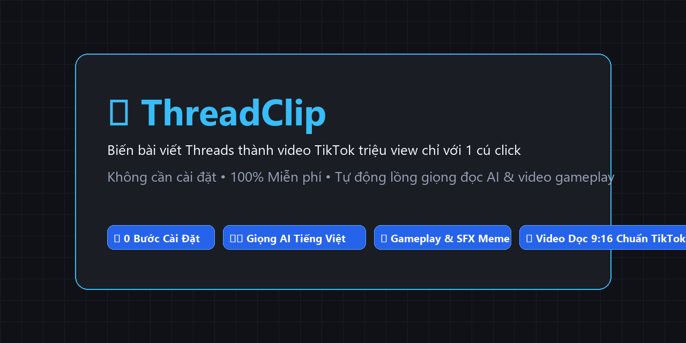

# 🎬 ThreadClip

> **Biến bài viết Threads thành video TikTok triệu view chỉ với 1 cú click.**  
> *Không cần biết lập trình • Không cần cài đặt phức tạp • 100% Miễn phí không tốn tiền API.*

---

## 📸 Demo thực tế



*(💡 **Hướng dẫn tạo ảnh GIF demo động:** Bạn có thể mở ứng dụng, dùng phần mềm [ScreenToGif](https://www.screentogif.com/) quay lại 5 giây thao tác dán link $\rightarrow$ bấm tạo video $\rightarrow$ lưu thành `assets/demo.gif` và thay vào đây nhé!)*

---

## ⚡ Tải về sử dụng ngay (Dành cho Windows)

[](https://github.com/ducanhcah/threads2video_ducanhcah/releases/latest)

> 💡 **0 Bước Cài Đặt:** Bạn chỉ cần tải file `.zip` từ mục Releases về, giải nén và bấm chạy. Không cần cài Python, không cần cài FFmpeg, không cần cấu hình PATH!

---

## 🚀 3 Bước tạo video triệu view

```text
[1. Giải nén & Mở CHAY.bat] ──> [2. Dán link bài Threads] ──> [3. Bấm TẠO VIDEO]
```

- **Bước 1:** Tải file về máy, giải nén ra thư mục và nhấp đúp vào **`CHAY.bat`**.
- **Bước 2:** Sao chép link bài viết Threads bất kỳ (app sẽ tự động nhận diện link từ bộ nhớ tạm).
- **Bước 3:** Chọn phong cách (*⚡ Viral nhanh*, *☕ Tâm sự* hoặc *🤣 Hài hước*) rồi bấm **🚀 TẠO VIDEO NGAY**.  
  *Video hoàn thành sẽ tự động mở lên, kèm tiêu đề và hashtag TikTok đã soạn sẵn!*

---

## ❓ 3 Câu hỏi thường gặp (FAQ)

<details>
<summary><b>1. Tôi không biết gì về lập trình có dùng được không?</b></summary>
<br>
<b>Hoàn toàn được!</b> Bạn không cần gõ bất kỳ dòng lệnh nào. Ứng dụng đã được đóng gói sẵn để bạn chỉ cần nhấp đúp chuột và sử dụng giao diện trực quan 100%.
</details>

<details>
<summary><b>2. Giọng đọc AI có bị tính phí hay giới hạn số lượng không?</b></summary>
<br>
<b>100% Miễn phí và không giới hạn!</b> ThreadClip sử dụng công nghệ giọng đọc Microsoft Edge Neural TTS cao cấp (tự động nhận diện Nam/Nữ và dịch teencode Gen Z), không dùng API trả phí của OpenAI hay Claude.
</details>

<details>
<summary><b>3. Tôi có thể đổi video nền và đóng dấu bản quyền kênh của mình không?</b></summary>
<br>
<b>Có!</b> Bạn chỉ cần bấm vào mục <i>"⚙️ Tùy chọn nâng cao"</i> trên giao diện để điền tên kênh (ví dụ: <code>@kenhcuaban</code> - app sẽ tự lưu lại cho lần sau) hoặc chọn file video gameplay MP4 từ máy tính của bạn.
</details>

---

<details>
<summary><b>💻 Dành cho Lập trình viên & Tự động hóa qua CLI</b></summary>
<br>

Xem toàn bộ tài liệu về tham số dòng lệnh CLI và giải pháp chuyên sâu tại:  
👉 **[Hướng dẫn CLI & Cấu hình Nâng Cao (docs/CLI_AND_ADVANCED.md)](docs/CLI_AND_ADVANCED.md)**
</details>

---

## 📄 Bản quyền & Đóng góp
- Mã nguồn phát hành theo giấy phép **[MIT License](LICENSE)**.
- Chi tiết nguồn tài nguyên âm nhạc, hiệu ứng meme và thư viện: xem tại **[CREDITS.md](CREDITS.md)**.
